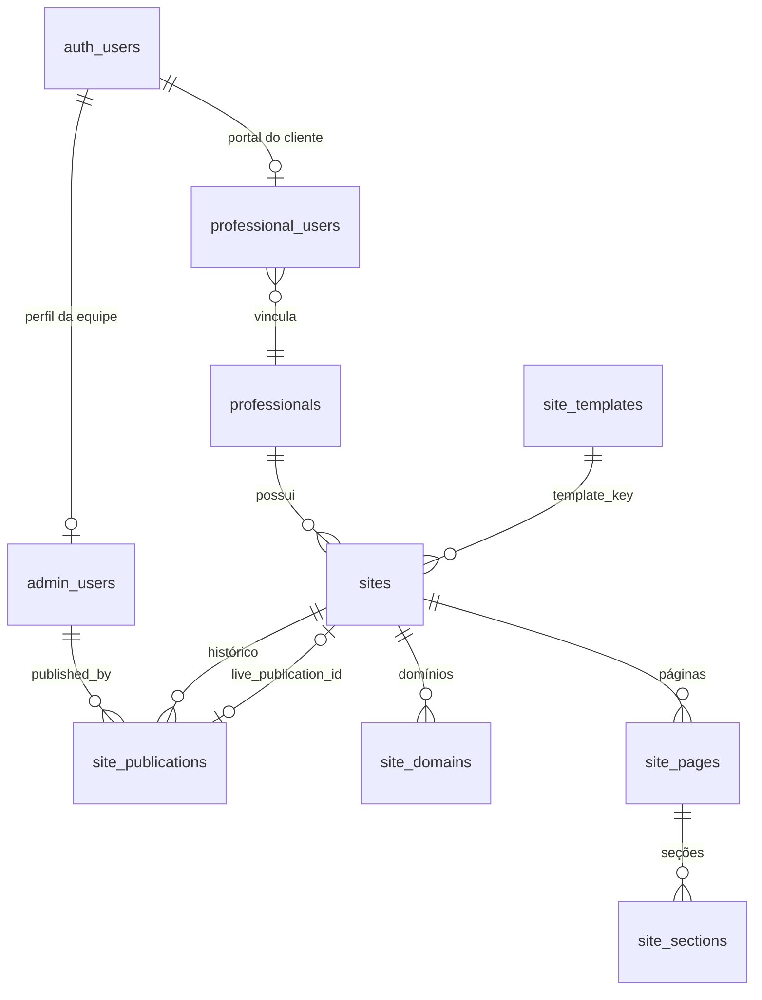

# Banco de dados

Projeto Supabase `uejagjwfvdhpfhpazjhi`, PostgreSQL 17. O schema é criado pelas migrations em `supabase/migrations/`.

## Entidades



| Tabela | Papel |
| --- | --- |
| `admin_users` | Equipe com acesso ao painel. `id` é o mesmo de `auth.users`. Papéis `editor`, `admin` e `super_admin`. Coluna `email` espelha o Auth para listagem |
| `professional_users` | Vínculo Auth ↔ professional para o portal `/app` |
| `professionals` | Cadastro do cliente: identidade, registro (CRP/CRM e RQE), contato, endereço, modalidades, status e notas internas |
| `site_templates` | Catálogo dos templates do código: `acolhedor`, `minimalista` e `premium` |
| `sites` | Site de um profissional: slug na plataforma, template, tema, SEO padrão, arquivamento e publicação no ar |
| `site_domains` | Domínios personalizados, com domínio principal e status de verificação e configuração |
| `site_pages` | Páginas do site. A inicial tem `path = '/'` |
| `site_sections` | Módulos de cada página: `module_key`, `section_key`, ordem, `content`, `settings` e visibilidade |
| `site_publications` | Histórico imutável dos snapshots publicados |

## Relacionamentos e exclusões

| Relação | Regra ao excluir |
| --- | --- |
| `admin_users.id` → `auth.users.id` | Cascade |
| `sites.professional_id` → `professionals.id` | Restrict |
| `sites.template_key` → `site_templates.key` | Restrict |
| `site_domains`, `site_pages`, `site_publications` → `sites` | Cascade |
| `site_sections.page_id` → `site_pages.id` | Cascade |
| `site_publications.published_by` → `admin_users.id` | Set null |
| `sites (id, live_publication_id)` → `site_publications (site_id, id)` | Chave composta: o site só aponta para uma publicação dele mesmo |

Unicidade: `sites.slug`, `site_domains.domain` (global), um domínio principal por site, `(site_id, path)` em páginas, `(page_id, section_key)` em seções e `(site_id, version)` em publicações.

## Soft delete

- Profissionais usam `status = 'archived'`. A exclusão física fica restrita ao `super_admin`, para pedidos de eliminação de dados, e só funciona sem sites vinculados.
- Sites usam `archived_at`. Um site arquivado não pode estar no ar.
- Páginas, seções e domínios são apagados de verdade. O conteúdo publicado fica preservado no snapshot.

## Publicação

O painel edita apenas o rascunho: `sites`, `site_pages`, `site_sections` e os dados do profissional. O site público lê apenas um snapshot.

| Função | Quem chama | Efeito |
| --- | --- | --- |
| `preview_site(site_id)` | `editor` ou acima | Monta o documento a partir do rascunho, sem gravar |
| `publish_site(site_id)` | `admin` ou acima | Valida o site, grava a versão seguinte em `site_publications` com data e autor, e aponta `sites.live_publication_id` para ela |
| `unpublish_site(site_id)` | `admin` ou acima | Zera `live_publication_id`. O histórico continua |
| `get_published_site_by_domain(domain)` | Público | Devolve o snapshot no ar de um domínio verificado |
| `get_published_site_by_slug(slug)` | Público | Devolve o snapshot no ar pelo slug da plataforma |

Prévia e publicação usam o mesmo montador, `private.build_site_document`. O documento é construído no banco a partir de uma lista fixa de campos. O cliente envia só o `site_id`, nunca o conteúdo.

Para publicar, o site não pode estar arquivado, o profissional não pode estar arquivado nem sem registro, e a página `/` precisa estar visível.

Estrutura do documento (`schema_version: 1`):

```json
{
  "schema_version": 1,
  "site": { "slug": "...", "template": { "key": "acolhedor", "version": 1 }, "theme": {}, "seo": {} },
  "professional": { "professional_name": "...", "council": "crp", "registration_number": "...", "whatsapp": "..." },
  "pages": [
    { "path": "/", "title": "Início", "seo": {}, "sections": [{ "key": "inicio", "module": "hero", "content": {}, "settings": {} }] }
  ]
}
```

O snapshot não inclui notas internas, status, ids nem seções e páginas ocultas. Dados do profissional entram como estavam no momento da publicação; uma alteração de telefone só aparece no site depois de republicar.

As funções de leitura pública devolvem `{ version, published_at, primary_domain, document }`, ou `null` quando não há site no ar.

## Segurança

- RLS ativo em todas as tabelas de `public`.
- `anon` não tem permissão em nenhuma tabela. O visitante só chama as duas funções `get_published_site_*`.
- As permissões vêm de `admin_users`, consultado por `private.has_role` a partir de `auth.uid()`. Uma conta do Auth sem linha ativa em `admin_users` não vê nada.
- Funções `security definer` ficam no schema `private`, fora da Data API. Os wrappers em `public` são `security invoker`.
- `site_publications` não aceita insert, update ou delete pela API. `sites.live_publication_id` não tem grant de escrita; só as funções de publicação alteram.
- Trigger em `sites` impede que `editor` troque profissional, slug, template ou arquivamento.
- Trigger em `admin_users` impede ficar sem `super_admin` ativo.
- O app usa só a chave publicável. A `service_role` não entra no Next.js.

### Políticas por papel

| Tabela | Leitura | Criação | Edição | Exclusão |
| --- | --- | --- | --- | --- |
| `admin_users` | Própria linha, ou equipe | `super_admin` | `super_admin` | `super_admin` |
| `professionals` | `editor` | `admin` | `admin` | `super_admin` |
| `site_templates` | `editor` | `super_admin` | `super_admin` | `super_admin` |
| `sites` | `editor` | `admin` | `editor`, com campos de admin protegidos | `super_admin` |
| `site_domains` | `editor` | `admin` | `admin` | `admin` |
| `site_pages`, `site_sections` | `editor` | `editor` | `editor` | `editor` |
| `site_publications` | `editor` | Só `publish_site` | Ninguém | Cascade do site |

"`editor`" significa `editor` ou acima; os papéis são hierárquicos.

### Acesso do profissional (portal)

Tabela `professional_users` vincula `auth.users` a um `professionals` (1:1). O login redireciona para `/app`. Policies extras em `professionals`, `sites`, `site_pages`, `site_sections` (e leitura de domínios/publicações/templates) aceitam o dono; publicar e gerir domínios continuam só com a equipe. Convite: Edge Function `invite-professional` (admin+).

## Migrations

| Versão | Arquivo | Conteúdo |
| --- | --- | --- |
| `20261116031907` | `admin_users_and_roles` | Schema `private`, papéis, `admin_users`, `has_role` |
| `20261116031946` | `professionals_and_sites` | Profissionais, templates, sites, domínios, páginas, seções e RLS |
| `20261116032016` | `site_publications` | Snapshots, ponteiro de publicação e funções de prévia, publicação e leitura pública |
| `20261117185758` | `site_media_bucket` | Bucket `site-media` (leitura pública; escrita `editor+`) |
| `20261117195703` | `admin_users_email` | Coluna `email` em `admin_users` para listagem da equipe |
| `20261117200753` | `professional_users` | Portal do profissional: vínculo Auth, helpers e RLS |

Os nomes dos arquivos usam as mesmas versões registradas no projeto remoto.

### Fluxo sem banco local

1. Criar o arquivo com `npx supabase migration new <nome>`.
2. Validar o SQL no remoto dentro de um bloco `do` que termine com `raise exception`, para tudo ser desfeito.
3. Aplicar com a ferramenta `apply_migration` do MCP `mindcare`.
4. Renomear o arquivo local para a versão que aparece em `list_migrations`.
5. Rodar `supabase/checks/rls_and_publication.sql` e os advisors de segurança e desempenho.

### Com banco local (Docker)

```bash
npx supabase start
npx supabase db reset
```

Para enviar ao remoto pela CLI, use `npx supabase link --project-ref uejagjwfvdhpfhpazjhi` e depois `npx supabase db push`.

### Verificação

`supabase/checks/rls_and_publication.sql` cria dados de teste, percorre os papéis e o fluxo de publicação, e termina sempre em erro para desfazer tudo. Rode no SQL Editor ou pelo MCP. O resultado certo é um erro `CHECKS_OK: ...`. Qualquer `FAIL: ...` indica regressão.

## Primeiro super_admin

O Auth do projeto ainda não tem usuários. Depois de criar sua conta em Authentication → Users, rode como `postgres`:

```sql
insert into public.admin_users (id, full_name, email, role)
select id, 'Seu nome', lower(email), 'super_admin'
from auth.users
where email = 'seu-email@exemplo.com';
```

Os próximos membros da equipe são convidados em `/admin/team` por um `super_admin` (Edge Function `invite-admin`).
